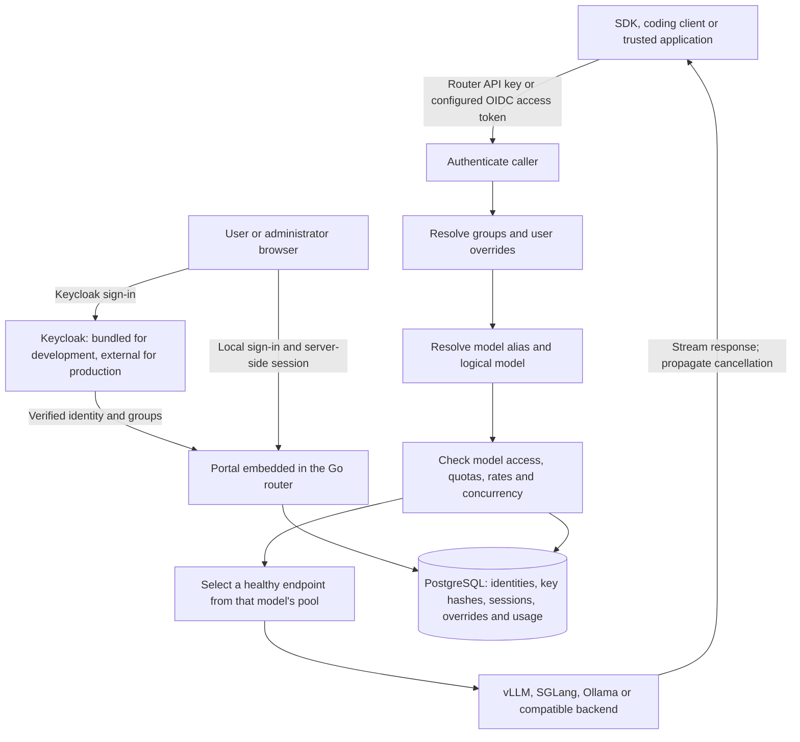

# Administrator guide

For a fresh installation, follow [Docker Compose or Kubernetes/Helm setup](INSTALL.md)
before continuing with administration below.

This guide describes local administration and the endpoint editor (12 November 2026). Start here
for setup, endpoint connections, group policies and user limits. Detailed operations
are in [RUNBOOK.md](RUNBOOK.md); production acceptance is in [PILOT.md](PILOT.md).
The [admin feature plan](ADMIN_FEATURE_PLAN.md) separates missing features from
working functionality.

## Personal request tracing

Every account has **My requests → Detailed logging**, enabled by default with a 7-day
lifetime. Users may disable capture, choose 1–30 days, inspect conversation/reasoning/tool
content and stream events, or delete their traces. Admin access does not permit reading
other users' content. Publish the updated [privacy notice](PRIVACY.md), protect Postgres
and backups as content-bearing storage, and see [the tracing guide](REQUEST_TRACING.md)
for capture bounds and operational behavior. Server logs, metrics and OTLP stay content-free.

## What an administrator can configure today

| Task | Current interface | When it applies |
|---|---|---|
| Add/edit/remove replicas for an existing model; change upstream model, protocols, timeouts, affinity, credential reference, weight or capacity | **Admin → Endpoint configuration** or portal API | Live after validation and health checks; saved in PostgreSQL |
| Add/remove logical model names or aliases | Private YAML | Router restart/recreation |
| Grant a group access to models; set group default limits | Private YAML | Router restart/recreation |
| Assign a person to a Keycloak group | Keycloak administration | Next portal login or successful group sync for API-key users |
| View users, group usage and replica health | Portal **Admin** | Live view; refresh to update |
| Override an individual user's limits | Portal **Admin**, portal API or `olr admin override` | Next request, for API keys, sessions and OIDC access tokens alike |
| Disable/re-enable a router user | Portal **Admin** or portal API; CLI can disable | Next request on every authentication path |
| Create a local API-key user | `olr admin user add` | Immediately; this creates no password login |
| Create a password-enabled local user; assign existing groups; reset an ordinary local password | Portal **Admin** or portal API | No restart; temporary passwords require replacement |
| Issue/revoke a user's API key as an operator | CLI create/revoke; **Admin** metadata listing/revoke | No restart; revoked keys stay revoked |
| Change Keycloak issuer, client IDs, claim names or secrets | YAML/environment, or [managed settings](#manage-authentication-settings-in-the-database): **Admin → Authentication** or `olr admin settings` | At once on the router where Admin activates it; other routers on restart or **Apply** |
| Test a Keycloak connection and sign-in before using it | **Admin → Authentication** connection checks and test sign-in | Immediately; nothing changes until activation |
| Configure group policies from the Admin page | **Not implemented** | See the feature plan |
| Log in with a local administrator password, including without Keycloak | Portal sign-in page or JSON API | Direct local route: `/portal/login/local` |
| Bootstrap a protected local administrator; rotate its password | CLI, optional startup secret; password change also through the portal API | No restart after CLI bootstrap |
| Recover a lost protected administrator password | `olr admin recover` on the host or in the router container | No restart; works without Keycloak |

The portal and local password API run without OIDC and during a Keycloak outage.
An ordinary CLI user has no password credential; putting it in an `admin: true`
group does not create one. The development account named `admin`
is a **Keycloak account**, not a protected local router administrator.

### Bootstrap the protected local administrator

Issue [#72](https://github.com/arm2arm/open-llm-router/issues/72) adds the reserved
router identity `(local, admin)`. Its admin authority is stored independently of
groups. API, CLI and database guards prevent deleting, disabling or demoting it,
removing its credential, renaming it or converting it into an SSO identity.
Database superusers, schema changes and intentional database destruction are
outside this guarantee. Ordinary local and SSO users keep their normal lifecycle.

With a built `olr` binary and `OLR_DATABASE_URL` pointing at the intended database,
create an owner-only secret file outside the checkout using your secret manager.
Passwords require at least 15 characters of valid UTF-8 and at most 1024 bytes.
Files must be regular files with no group/other permissions (0400 or 0600);
one final LF/CRLF is ignored and spaces are preserved. Keep password values out
of command arguments and shell history.

```sh
export OLR_BOOTSTRAP_ADMIN_PASSWORD_FILE=/private/secrets/olr-bootstrap
olr admin bootstrap
# Save the returned id; output contains identity metadata, never a password/hash.
export OLR_LOCAL_ADMIN_ID='PASTE_RETURNED_UUID_HERE'
olr admin password change -user "$OLR_LOCAL_ADMIN_ID" \
  -current-password-file "$OLR_BOOTSTRAP_ADMIN_PASSWORD_FILE" \
  -password-file /private/secrets/olr-admin-new
unset OLR_BOOTSTRAP_ADMIN_PASSWORD_FILE
```

Securely retire the bootstrap file after the change and store the replacement
password in your secret manager. The change requires the current password,
rejects reusing it, revokes existing sessions and clears authentication caches.
Until it succeeds, the account cannot establish a full portal session or issue
or authenticate API keys. Without the current password, use
[operator recovery](#recover-the-protected-local-administrator).

`olr serve` also bootstraps when `OLR_BOOTSTRAP_ADMIN_PASSWORD_FILE` or the secret
environment variable `OLR_BOOTSTRAP_ADMIN_PASSWORD` is supplied. Configure exactly
one source; there is no built-in password. Without either source, existing
deployments continue running and an operator can run explicit bootstrap later.
Once initialized, startup and repeated/concurrent bootstrap calls preserve the
same UUID and password and ignore retired inputs. An existing unprotected
`(local, admin)` is a conflict: bootstrap refuses to adopt it. An SSO account with
the same username/email remains a separate identity.

For containers, mount private files in a site-specific Compose override/secret
volume, readable by router UID 65532 and with owner-only permissions. Paths refer
to files **inside** the container. The development Compose file forwards both
bootstrap environment variables but does not create or mount a password file.
The production pilot passes variables from its private environment file.

The bootstrap secret is read only while no protected administrator exists.
Changing or removing `OLR_BOOTSTRAP_ADMIN_PASSWORD_FILE` /
`OLR_BOOTSTRAP_ADMIN_PASSWORD` later has no effect on the account, so retire it
after the first change. If a bootstrap secret was exposed before that change,
replace it with [recovery](#recover-the-protected-local-administrator).

Credentials use versioned Argon2id hashes with a random 16-byte salt, 64 MiB,
three passes, two lanes and a 32-byte result. `BenchmarkPasswordHash` measured
about 94 ms on an Apple M5 Max during local validation; repeat the benchmark on
deployment hardware when reviewing future hash versions. Verification accepts
only the version's bounded parameters. PostgreSQL backups contain password
hashes and must be protected as secrets.

### Recover the protected local administrator

If the protected administrator's password is lost, an operator with database
access resets it from the host or the router container. The command needs only
`OLR_DATABASE_URL`: it does not contact Keycloak, works during an IdP outage and
does not need a running router. Put a new temporary password (same rules as
bootstrap) in an owner-only file, then run one of:

```sh
# Host or a container with the file mounted inside it
olr admin recover -password-file /private/secrets/olr-recovery
# Compose: the distroless image has no shell, so redirect the host file
docker compose exec -T router olr admin recover -password-stdin < /private/secrets/olr-recovery
# Helm/Kubernetes
kubectl -n olr exec -i deployment/olr-open-llm-router -- \
  olr admin recover -password-stdin < /private/secrets/olr-recovery
```

Sign in at `/portal/login/local` as `admin` with the temporary password and
choose a replacement, or run `olr admin password change` with the recovery file
as `-current-password-file`. Then delete the recovery file.

| Effect | Detail |
|---|---|
| Old password | Stops working at once |
| Temporary password | Permits only the required change, like the bootstrap credential; full portal and API-key access resume after the replacement |
| Sessions | Every session of the account ends |
| API keys | Every key of the account is revoked; issue new ones afterwards |
| Identity | UUID, username and protected admin authority are unchanged |
| Router caches | Invalidated on every router before the command returns |

The command has no flag that names an account, so it can only replace this one
credential: it cannot target, disable, delete, rename or convert any identity.
Ordinary local users are reset under **Admin**. Recovery never reads the bootstrap
password sources and fails with `not bootstrapped` before bootstrap; a retired
bootstrap secret, at startup or through `olr admin bootstrap`, never resets the
recovered account. Reusing the current permanent password is refused.

Passwords are read only from a private file or redirected/piped standard input,
never from flags. `-password-stdin` refuses a terminal, where typing would echo.
Standard output contains identity metadata and counts, never the password or hash:

```json
{"id":"…","username":"admin","protected_admin":true,"must_change_password":true,"credential_replaced":true,"sessions_revoked":1,"keys_revoked":0}
```

If the command reports `change committed but cache invalidation was not
acknowledged; retry the command`, run it again with the same file. A retry with
the pending temporary password revokes sessions and keys again without changing
the credential (`"credential_replaced": false`).

Every attempt with a valid command line writes one JSON audit line to standard
error. It identifies the operating-system account and host, the target UUID, the
result (`succeeded`, `refused` or `failed`), a sanitized reason and counts, and
never contains credentials or file paths:

```json
{"time":"…","level":"INFO","msg":"admin audit","event":{"time":"…","action":"local_admin.recover","actor":{"type":"operator_cli","name":"nonroot","host":"…"},"target_id":"…","result":"succeeded","details":{"credential_revision":3,"keys_revoked":0,"sessions_revoked":1}}}
```

Keep standard error in your operations log. A persistent, searchable
administration history is tracked in
[#84](https://github.com/arm2arm/open-llm-router/issues/84).

**Backups and restore.** Restoring a PostgreSQL backup returns the protected
administrator's credential to the state in that backup: the password valid at
backup time works again, and sessions or keys created later are gone. If that
password is unknown, run recovery after the restore. Backups contain password
hashes; protect them as secrets.

### Manage authentication settings in the database

The SSO connection (issuer, back-channel URL, portal client ID and secret, API
audience, claim names, required claim, sync client ID/secret and interval) can
move from YAML/environment into PostgreSQL revisions with `olr admin settings`.
Use **Admin → Authentication** in the portal (activation applies at once) or
the CLI below (routers apply its activations when they restart or on **Apply**).
`OLR_DATABASE_URL`, bootstrap and encryption keys, the listener, `PORTAL_BASE_URL`,
cookie settings, models and groups are never managed here.

The domain stays **file-managed** until an explicit import. Import copies the
current effective values exactly, so behavior does not change; a client secret
set in the environment becomes a reference to that same variable. From then on
the active database revision is the **only** authority for these settings.

```sh
olr admin settings show            # effective values, their source, and "version"
olr admin settings import          # make the database the authority (once)
olr admin settings show > current.json   # copy .active.document into draft.json and edit it
olr admin settings draft -expect-version 1 -document draft.json \
  -secret sync_client_secret=/private/secrets/olr-sync
olr admin settings activate -expect-version 2 -revision 2
# Later, with the version and revision IDs from the latest show:
olr admin settings rollback -expect-version VERSION -revision PREVIOUSLY_ACTIVE_ID
olr admin settings discard -expect-version VERSION   # drop a pending draft
```

In Compose, run them as `docker compose exec -T router olr admin settings ...`;
the commands read `OLR_CONFIG`, `OLR_DATABASE_URL` and the router's environment.
Each prints the view as JSON:

| Field | Meaning |
|---|---|
| `managed`, `version` | Whether the database is the authority; pass `version` as `-expect-version` to the next change |
| `effective` | Every setting with its value and source: `database`, `file`, `environment` or `default`. Secrets show `configured`, `reference` (`environment` or `stored`), id/time and `available`, never the value |
| `active`, `draft` | The active revision and the pending draft, with their documents (secret references only) and the latest check |
| `conflicts` | File/environment values that differ from the active revision, by setting and location (`oidc.issuer`, `OIDC_ISSUER`), never values |
| `history` | Recent revisions: `active`, `draft`, `previously_active` or `superseded` |

**Drafts and activation.** A draft is based on the active revision. Documents
are read strictly: unknown fields, wrong types, invalid URLs or claim settings,
and secret references to any variable other than the setting's own
(`OIDC_PORTAL_CLIENT_SECRET`, `OIDC_SYNC_CLIENT_SECRET`) refuse the save. A
saved draft is checked against this process: secrets must resolve, the result
must be a valid configuration, and no file/environment value may contradict
it. A failing check is stored on the draft and blocks only its activation; the
active revision is unchanged. Activation and rollback check again. Rollback
accepts only previously active revisions and keeps a pending draft. Every
change requires the current version: a concurrent edit fails with `settings
changed since you loaded them` instead of overwriting. **Routers apply the
active revision when they start**, so recreate them after activation.

**Single authority.** To change a setting that YAML or the environment still
sets, remove it there first (for example `OIDC_ISSUER` from Compose or Helm
values) and recreate the router; otherwise activation is refused with the
location to remove. At startup a conflicting file/environment value is
ignored and logged as an error; the active revision still applies.

**Secrets.** `-secret NAME=FILE` reads a private file (same rules as password
files) and stores the value encrypted with AES-256-GCM under
`OLR_SETTINGS_ENCRYPTION_KEY`, a base64-encoded 32-byte key supplied outside the
database (`openssl rand -base64 32`). Each stored value is a new immutable row
bound to its id and setting name; the draft references it, so activation is the
rotation and rollback restores the earlier secret. Plaintext is never returned
by the CLI, written to revisions, logs, validation messages or audit events.
Without the key, environment references keep working but stored secrets can be
neither saved nor opened. Keep the key stable and back it up separately from
PostgreSQL: a database backup alone cannot reveal stored secrets.

**Failure and local administration.** If the active revision cannot be applied
at startup (for example, the key is missing or different, or a referenced
variable is unset), the router starts with SSO off and logs `SSO is off and local
login remains available`. It never falls back to file values. Local login,
recovery and API keys keep working; restore the key or activate/roll back to a
revision that applies, then recreate the router.

**History.** Imports, draft saves, discards, activations and rollbacks,
including refused attempts, are recorded in the append-only `audit_events`
table with actor, revision, result and changed setting names. Database triggers
refuse `UPDATE`, `DELETE` and `TRUNCATE` on revisions (except their check
result), activations, stored secrets and audit events. Database superusers,
schema changes and intentional database destruction are outside this
guarantee, as for the protected administrator. A searchable history view is
[#84](https://github.com/arm2arm/open-llm-router/issues/84).

### Configure and test Keycloak in Admin

**Admin → Authentication** shows the configuration authority (file or database
revision), the revision this router is running, whether Keycloak is reachable,
every effective value with its source, and the exact URLs to register on the
Keycloak portal client: **Valid redirect URI** `<origin>/portal/callback`,
**Valid post logout redirect URI** `<origin>/` and **Web origin** `<origin>`.

Any administrator can view the page. Importing, saving or discarding drafts,
running checks and test sign-ins require a **local** administrator session from
the last 15 minutes; sign in again at `/portal/sign-in/local` when the page says
so. A Keycloak session cannot reconfigure its own identity provider.

1. **Import current settings** (once) makes the database the authority without
   changing how anyone signs in.
2. Edit the draft: SSO on/off, the primary sign-in option (Keycloak or local;
   both stay available), issuer, back-channel URL, portal client, API audience,
   claim names, optional required claim, sync client and interval. For each
   secret choose *keep*, the setting's own environment variable, *store a new
   secret* (needs `OLR_SETTINGS_ENCRYPTION_KEY`) or *none*. **Save draft** never
   changes the running configuration; the draft's problems are listed.
3. **Run checks** on the draft (or on the current settings before importing):

| Check | Passes when |
|---|---|
| Discovery | The issuer's OpenID configuration is readable (through the back-channel URL if set) and names this exact issuer |
| Logout metadata | An `end_session_endpoint` is published, so sign-out also ends the Keycloak session |
| Portal client credentials | The portal client ID and secret authenticate at the token introspection endpoint |
| Service-token audience | A token for the optional test service client (for example `olr-service`) names the API audience; the client is used once and not stored |
| Sync permissions | The sync service account obtains a token and can list users (`realm-management` `view-users`) |

4. **Test sign-in** sends your browser to Keycloak with the draft's settings and
   back to the normal callback. The router verifies the identity token, the
   username and groups claims and the required claim, records the result on the
   draft and returns you to the Admin page. No router user or session is created;
   your local session is kept. Register the redirect URI above on the draft's
   client first; sign in as a representative user of the realm.
5. **Activate draft** once no check failed and the test sign-in passed (turning
   SSO off needs neither). The router first connects to the new provider; if it
   is unreachable, nothing changes. Then the database activation and the switch
   happen together: the portal's login client, API-token verification and group
   sync move to the new revision, and the old clients and sync job stop. No
   restart or image rebuild is needed.

### Activate, roll back and apply

| Action | Effect |
|---|---|
| **Activate draft** | Requires passed checks and test sign-in for an SSO-enabled draft and a reachable provider. Applies at once on this router |
| **Roll back** (history) | Re-activates a previously active revision without new checks, even while that provider is down; SSO then reports unavailable and retries every 10 seconds |
| **Apply active revision to this router** | Shown when this router runs something else, for example after `olr admin settings activate` or a rollback on another router |

Other router processes apply a new active revision when they restart or when
**Apply** is used on their own Admin page. Local sign-in, recovery, API keys and
`/readyz` never depend on the SSO configuration; the page reports SSO health
separately as *Keycloak reachable/unavailable*.

**Changing the issuer** starts a new identity namespace. Router accounts are keyed
by issuer and subject and are never linked by email or username, so the same
person gets a new account under the new issuer. On the switch, pending SSO logins
are discarded and SSO sessions of other issuers stop working (sessions are checked
against the current issuer). Accounts of previous issuers keep their UUIDs, usage
and API keys, but group sync no longer updates or disables them: the page lists
them under *Accounts of previous identity providers*. Disable those users under
**Users** when they should lose access. Rolling back to the previous issuer makes
its accounts and sessions usable again.

Failed checks name the problem without showing secrets or provider responses
(for example *the provider rejected the portal client ID or secret*). Checks and
test sign-ins contact only the configured issuer, never follow redirects and
refuse link-local, metadata, multicast and unspecified addresses. This page
manages the router's connection only: realms, clients, brokering and group
membership stay with the Keycloak administrator. Local sign-in stays available
throughout.

### Use local authentication without Keycloak

Open `/portal/` to choose a sign-in method. **Continue with Keycloak** is the
primary option when Keycloak is configured; the local username/password form
remains visible. With no Keycloak configuration, only local sign-in is offered.
During an outage the Keycloak action is disabled and local login stays available.
Use `/portal/login/local` to go directly to local sign-in without contacting or
redirecting to Keycloak. This route also lets an already signed-in Keycloak user
switch to a local account; successful local login replaces the old session.

Sign in as `admin` with the bootstrap password. The portal requires a replacement
of at least 15 characters before allowing workspace or Admin access. Enter the
bootstrap password in **Current password**, choose and confirm the replacement,
then sign in again. Later changes are under **Account** and sign out all local
sessions. **Sign out** invalidates the current session and returns to the public
homepage; local logout never needs Keycloak. Session cookies are HttpOnly and
passwords are not put in URLs or browser storage.

The sidebar and **Account** page label the identity as **Protected local
administrator**, **Local account**, or **Keycloak account**. The bundled realm's
`admin` is a Keycloak account with a separate UUID and credentials. Keycloak users
manage their password through their organization, rather than this local form.
Admins can create additional local password users and set a password on an existing
CLI API-key user. CLI-created users do not automatically acquire credentials.

Set `PORTAL_BASE_URL` to the public HTTPS origin. For local HTTP only, explicitly
set `PORTAL_COOKIE_SECURE=false`. An HTTP origin with secure cookies leaves the
API server running but refuses cookie-issuing login operations. Omitting `oidc`
enables local-only authentication; no Keycloak realm is needed.

For API-based access, create owner-only JSON files with your secret manager outside the checkout:
`local-login.json` holds `{"username":"admin","password":"<current password>"}`;
`local-change.json` holds `{"current_password":"<current password>","new_password":"<replacement>"}`.
Keep those values out of shell arguments/history. Use a private cookie jar:

```sh
umask 077
export OLR_PORTAL_ORIGIN=https://llm.example.org
curl --fail "$OLR_PORTAL_ORIGIN/portal/api/auth"
curl --fail -c /private/secrets/olr-cookies \
  -H "Origin: $OLR_PORTAL_ORIGIN" -H 'Content-Type: application/json' \
  --data-binary @/private/secrets/local-login.json \
  "$OLR_PORTAL_ORIGIN/portal/login/local"
curl --fail -b /private/secrets/olr-cookies -c /private/secrets/olr-cookies \
  -H "Origin: $OLR_PORTAL_ORIGIN" -H 'Content-Type: application/json' \
  --data-binary @/private/secrets/local-change.json \
  "$OLR_PORTAL_ORIGIN/portal/password"
```

The first login returns `must_change_password: true` and a ten-minute restricted
session. Only session status, password change and logout are permitted. A successful
change revokes all sessions and returns `login_required: true`. Update the private
login JSON to the replacement password, repeat the login command, and then use the
cookie jar for `/portal/api/me` or `/portal/api/admin/users`. A full session lasts
eight hours and carries protected admin authority independently of group policies.
Retire the one-time files and cookie jar when finished. Password rotation binds
sessions to a new credential revision, so even a delayed login using an old
verification cannot create a usable session.

`POST /portal/logout` with `{}` and the same Origin/cookie revokes that session.
Local logout never contacts Keycloak. Portal cookies do not authorize `/v1/*`;
clients still need an API key or a configured OIDC access token.

Local login and password change share fixed one-minute limits: ten attempts per
username, twenty per source address and sixty overall. The router ignores
forwarding headers for this purpose; clients behind a reverse proxy share its
source-address limit. `429` includes `Retry-After`. Rejected requests do not extend
the window or disable any account. Throttle buckets are hashed, bounded in count
and stored in PostgreSQL; two password operations can run concurrently per process.

OIDC discovery, API-token verification initialization and group-sync initialization
run independently of listening. Failed initialization retries every ten seconds.
`GET /portal/api/auth` reports SSO discovery availability separately; affected SSO
API login routes return 503 during an outage; the browser Keycloak entry returns
to the sign-in page with the local alternative. Existing local sessions, local login, Admin,
API keys and readiness remain independent of Keycloak. Discovery health is polled
every ten seconds, and SSO can recover without a router restart.

## How the project works



Keycloak establishes identity and group memberships. Router YAML defines what each
group can use. A **logical model** is the public name used by clients; its **pool**
contains one or more backend origins serving the configured `upstream_model`.
Aliases map additional client names to the logical model and inherit its access rules.

Group access is therefore **group → logical model → endpoint pool**. There is no
independent provider registry, group-to-replica permission or per-provider quota.
Use separate logical models and separate pools when groups must reach different
backends. Every endpoint in one pool must serve the same upstream model and the
protocols enabled for that logical model.

The router forwards native OpenAI and Anthropic request/response formats. Enabling
`anthropic` does not convert an OpenAI-only backend into an Anthropic backend.
The supported inference routes are `/v1/chat/completions`, `/v1/completions`,
`/v1/embeddings`, `/v1/messages` and `/v1/messages/count_tokens`.
`/v1/responses` is not implemented.

## 1. Start the complete local test environment

Install Git and Docker with Compose 2.20 or later. The Docker build supplies the Go
and Node toolchains; a local evaluation needs no GPU or external identity provider.

```sh
git clone https://github.com/arm2arm/open-llm-router
cd open-llm-router
docker compose up --build -d --wait --wait-timeout 180
docker compose ps
curl --fail http://localhost:8080/healthz
curl --fail http://localhost:8080/readyz
```

| Component | Local address | Account/purpose |
|---|---|---|
| Router and portal | `http://localhost:8080/portal/` | Sign in through the local Keycloak |
| Keycloak administration | `http://localhost:8081/admin/` | `admin` / `keycloak-admin-dev-only` |
| Router administrator in realm `olr-dev` | Portal login | `admin` / `admin-dev-only`; group `admins` |
| Regular users in realm `olr-dev` | Portal login | `staff` / `staff-dev-only`; `student` / `student-dev-only` |
| PostgreSQL | `localhost:5432` | Database/user `olr`, password `olr-dev-only` |
| Mock replicas | `http://localhost:8001`, `http://localhost:8002` | Deterministic responses, not real model inference |

These are public development credentials. The Keycloak administration account and
the `olr-dev` portal account are different accounts despite sharing the name `admin`.
Keycloak imports `olr-dev` and the brokered `upstream-idp` test realm into its data
volume. Editing realm JSON does not update an already initialized volume.

1. Sign into the portal as the realm's `admin` user.
2. Open **Admin** and inspect users, group totals and replica health.
3. Open **API keys**, create a key, and save the value shown once.
4. Use it from a terminal:

```sh
export OLR_API_KEY='PASTE_THE_ROUTER_KEY_HERE'
curl --fail http://localhost:8080/v1/models \
  -H "Authorization: Bearer $OLR_API_KEY"
curl --fail -N http://localhost:8080/v1/chat/completions \
  -H "Authorization: Bearer $OLR_API_KEY" \
  -H 'Content-Type: application/json' \
  -d '{"model":"chat-model","messages":[{"role":"user","content":"Hello"}],"stream":true,"max_tokens":64}'
```

For overrides, copy [.env.example](../.env.example) to `.env` and adjust ports or
development settings. Apply changed Compose environment values with
`docker compose up -d --force-recreate router`. A plain `docker compose restart`
does not update a container's environment. `docker compose down` stops the stack
and preserves named volumes; `down --volumes` deletes its database and realm data.

For a real local Ollama backend, follow the laptop setup in [README.md](../README.md).
GPU server examples and client requirements are in [CLIENTS.md](CLIENTS.md).

## 2. Prepare a production installation

The standalone production Compose file runs **only the router**. Provision the
following services separately before starting it:

| Dependency | Required site values |
|---|---|
| PostgreSQL 17 | Dedicated database and login, TLS connection URL, backup/restore owner; the router login must be able to apply schema migrations |
| Production Keycloak | Reachable HTTPS realm issuer, portal and sync client secrets, groups and claim mappings |
| Model servers | Reachable origins, served model names, native protocols, authentication and health paths |
| Docker host and TLS proxy | Public HTTPS origin, certificate, router listener restricted to loopback, firewall access to dependencies |
| Operations | Tested image digest, quotas/capacities, metrics token, alerts, retention and privacy notice |

Run **one router instance**. RPM, TPM, concurrency, queue and affinity state are
in memory; multiple instances do not share those limits. The router migrates its
database on startup. Keep the deployment files outside this public repository.

### Configure the Keycloak realm

In the site's Keycloak administration console:

1. Create/select the production realm and record its issuer, such as
   `https://sso.example.org/realms/llm`.
2. Create groups for the YAML policies you will use. Start with distinct, flat
   names such as `staff`, `students`, `external-users` and `admins`; assign pilot
   users and at least one administrator.
3. Create confidential client `olr-portal` with authorization-code login, client
   authentication and PKCE S256. Register the exact redirect
   `https://llm.example.org/portal/callback` and post-logout redirect
   `https://llm.example.org/`. Record its client secret.
4. Add a group-membership mapper with claim name `groups`, included in ID tokens
   and, where used, access tokens. With the default `oidc.group_names: leaf`,
   set **Full group path off** (full paths are also accepted and reduced to leaf
   names). For realms whose nested groups share leaf names, use
   `group_names: path` with **Full group path on** and name policies by path,
   for example `/org/staff`. See [group names](#group-names-and-authorization-freshness).
5. For service access tokens, create audience client `olr-api`. Give each actual
   service client an audience mapper adding `olr-api` to access tokens and the
   required group memberships/claim. The audience client itself is not a login.
6. Create confidential client `olr-sync` with service accounts and the
   `realm-management` role `view-users`. For Keycloak 26.8+ add its `kc-admin-api`
   client scope. Record the sync client secret. The production Compose template
   requires this secret; the router itself can run without sync if it is omitted
   in a different deployment definition.
7. If federated institutional login is needed, configure the broker in Keycloak.
   The router still trusts the one Keycloak issuer. Set an optional required
   login claim with `OIDC_REQUIRED_CLAIM=name=value`.

The current router does not create or edit Keycloak realms, users, groups or
clients. It consumes their settings. Generic OIDC can provide portal login, but
the periodic group-sync implementation specifically uses Keycloak's admin API.

### Prepare the image and private files

Build the current source and publish it to a registry accessible by the target host,
or use a tested image already published by your team. For example, on a build host
matching the deployment architecture:

```sh
docker build --target olr -t registry.example.org/team/olr:pilot .
docker push registry.example.org/team/olr:pilot
docker image inspect registry.example.org/team/olr:pilot --format '{{json .RepoDigests}}'
```

Use the matching `registry/image@sha256:...` repository digest as `OLR_IMAGE`.
The host paths below are examples; the parent directory stays private and the
non-root container must be able to read the mounted YAML.

```sh
umask 077
mkdir -p "$HOME/.config/olr-pilot"
cp deploy/compose/pilot.env.example "$HOME/.config/olr-pilot/pilot.env"
cp deploy/compose/pilot.config.example.yaml "$HOME/.config/olr-pilot/config.yaml"
chmod 700 "$HOME/.config/olr-pilot"
chmod 600 "$HOME/.config/olr-pilot/pilot.env"
chmod 644 "$HOME/.config/olr-pilot/config.yaml"
export OLR_PILOT_ENV_FILE="$HOME/.config/olr-pilot/pilot.env"
```

Edit `pilot.env`. Fill every required empty value: image digest, absolute
`OLR_SITE_CONFIG` path, PostgreSQL URL, HTTPS issuer and portal origin, OIDC secrets,
metrics token, backend origins/keys and served model. Choose group limits,
retention and measured replica capacity rather than adopting example values blindly.
Single-quote values containing `$`, `#` or spaces. Do not `source` this file;
Compose reads it as an environment file. Use a deployment shell without conflicting
exported development settings, since shell values can override Compose interpolation.

Set the TLS reverse proxy as described in [RUNBOOK.md](RUNBOOK.md#behind-a-tls-reverse-proxy):
buffering off, 4 MiB body limit, timeouts at least the largest model timeout,
and private access to `/metrics`. The pilot file forces secure cookies and clears
the development `OIDC_BACKCHANNEL_URL`.

```sh
docker compose -f deploy/compose/pilot.yml --env-file "$OLR_PILOT_ENV_FILE" config --quiet
docker compose -f deploy/compose/pilot.yml --env-file "$OLR_PILOT_ENV_FILE" pull
docker compose -f deploy/compose/pilot.yml --env-file "$OLR_PILOT_ENV_FILE" up -d
docker compose -f deploy/compose/pilot.yml --env-file "$OLR_PILOT_ENV_FILE" logs --tail=100 router
```

`config --quiet` checks Compose, **not the router YAML or external connectivity**.
There is currently no standalone `olr config check` command. Startup parses YAML
strictly, opens/migrates the database and configures OIDC. Poll `/healthz` and
`/readyz` through the HTTPS origin with a bounded retry period; both must return
200. Readiness requires the database and a healthy replica for **every** configured
model. Then complete the production checks in [PILOT.md](PILOT.md#acceptance-before-onboarding).

## 3. Add endpoints and assign them to groups

The following is a complete example router YAML. Use it as a replacement for the
private example when you need a local GPU model and a separate remote compatible
backend. The remote origin is illustrative; this does not establish compatibility
with a commercial provider. Keep the same private `pilot.env`, adding
`REMOTE_API_ORIGIN`, `REMOTE_UPSTREAM_MODEL`, `REMOTE_API_KEY` and
`REMOTE_HEALTH_PATH`. The pilot Compose file passes custom variables to the router.

```yaml
auth:
  default_key_lifetime_days: 90
limits:
  timezone: Europe/Berlin
retention:
  usage_days: 90
  usage_daily_days: 400
  run_at: "03:00"
oidc:
  issuer: ${OIDC_ISSUER}
  portal_client_id: olr-portal
  groups_claim: groups
  username_claim: preferred_username
  audience: olr-api
  sync_client_id: olr-sync
  sync_interval_s: 900
models:
  chat-model:
    protocols: [openai, anthropic]
    upstream_model: ${OLR_UPSTREAM_MODEL}
    timeout_s: 900
    idle_timeout_s: 60
    queue_timeout_s: 10
    session_affinity: true
    pool:
      - url: ${OLR_BACKEND_A_URL}
        health_path: /health
        bearer_token_env: VLLM_A_API_KEY
        weight: 2
        max_inflight: 8
      - url: ${OLR_BACKEND_B_URL}
        health_path: /health
        bearer_token_env: VLLM_B_API_KEY
        weight: 1
        max_inflight: 4
  external-chat:
    protocols: [openai]
    upstream_model: ${REMOTE_UPSTREAM_MODEL}
    timeout_s: 120
    idle_timeout_s: 60
    queue_timeout_s: 5
    pool:
      - url: ${REMOTE_API_ORIGIN}
        health_path: ${REMOTE_HEALTH_PATH}
        bearer_token_env: REMOTE_API_KEY
        weight: 1
        max_inflight: 4
groups:
  students:
    models: [chat-model]
    tokens_per_day: 300000
    tokens_per_month: 6000000
    rpm: 20
    tpm: 20000
    max_concurrent: 2
    max_concurrent_batch: 2
  staff:
    models: [chat-model]
    tokens_per_day: 2000000
    tokens_per_month: 20000000
    rpm: 60
    tpm: 100000
    max_concurrent: 4
    max_concurrent_batch: 8
  external-users:
    models: [external-chat]
    tokens_per_day: 300000
    tokens_per_month: 6000000
    rpm: 20
    tpm: 20000
    max_concurrent: 2
    max_concurrent_batch: 2
  admins:
    models: [chat-model]
    admin: true
    tokens_per_day: 300000
    tokens_per_month: 6000000
    rpm: 20
    tpm: 20000
    max_concurrent: 2
    max_concurrent_batch: 2
aliases:
  coding-assistant: chat-model
```

In this example students can use `chat-model` and `coding-assistant`; membership
in `external-users` adds `external-chat`. An administrator needs that membership
too to use `external-chat`: `admin: true` enables administration, while `models`
controls inference access. The repository's development `admins` policy instead
uses `models: ["*"]` and omits limits, intentionally granting unrestricted access.

### Configure endpoints in Admin

Sign in with a full local or Keycloak admin session and open **Admin → Endpoint
configuration**. Select **Edit endpoints** for the public model your clients use.
You can add or remove replicas, change each origin, health path, weight,
`max_inflight` and credential reference, and edit the model's upstream name,
native protocols, header/idle/queue timeouts and session affinity. Each model
must retain at least one replica; at most 32 replicas are accepted.

1. Set each **Backend origin** without `/v1`. All replicas in a pool must serve
   the same upstream model and native protocols.
2. Choose a server-provided **Credential reference**, or **None** for an
   unauthenticated backend. Secret values cannot be entered or read in the UI.
3. The editor automatically detects models after origins or credentials change.
   Choose **Detected upstream models** or click **Refresh models**. Only names
   available on every replica are offered. One detected name fills an empty
   **Upstream model name**; an existing/manual name is never replaced automatically.
   OpenAI-compatible `/v1/models` and Ollama `/api/tags` catalogs are supported.
   Discovery failures leave manual entry available and do not save a revision.
4. Click **Test connections**. This checks HTTP-200 health responses, not whether
   the named model is installed or supports tools. No revision is saved.
5. Click **Save and apply**. The server validates and checks again, commits a new
   revision, then switches new requests to it. Existing streams finish with their
   original configuration. User concurrency, quotas and usage accounting continue.
6. Make a real completion with a permitted user's router key. Clients keep using
   the public model name and the router's `/v1` URL.

A failed validation/check keeps the active revision. If another admin saved first,
your draft stays open with a conflict; discard/reload it before editing again.
**Revision history and restore** previews older configurations and can restore
one, or the **current YAML/environment configuration**, after another health check.
Restore creates a new revision, so stale browser tabs cannot overwrite it.

**Example: route `chat-model` to LAN Ollama.** Edit `chat-model`, replace its mock
replicas with origin `http://192.168.178.81:11434`, and enter the exact installed
Ollama model name, for example `qwen3.8:27b-mlx`. Enable **OpenAI** and disable
**Anthropic** unless that backend supports it. Choose **Use Ollama health and
capacity defaults** to set health path `/`, capacity `1`, header timeout `900`
seconds and idle timeout `120` seconds. Use weight `1` and no credential for an
unauthenticated Ollama. Test, save, then send an actual completion. Hermes should
still use the router base URL `http://localhost:8080/v1` and model `chat-model`.

Streaming, thinking, tool calling and images use the backend's native API. The
router preserves those request fields and response events; it cannot add a
capability the selected model lacks. For OpenAI clients, request `stream: true`,
read SSE incrementally, and display `delta.reasoning_content` separately from
`delta.content`; tools arrive in `delta.tool_calls`. Images use image content
parts. Anthropic clients keep their native thinking/image/tool blocks. For a
command-line stream check, use `curl -N` (without output buffering).

For Hermes, configure the selected profile's `display.streaming: true` and
`display.show_reasoning: true`. Messaging gateways also require
`streaming.enabled: true`; restart the affected Hermes session/gateway after
changing its configuration. Reasoning controls must match the selected backend
model; for example use `agent.reasoning_effort: low` if that level is supported.

### Replace lost API keys

API keys are shown once at creation. Administrators cannot recover or copy an existing
user key. Ask the user to create a replacement on **API keys**, update the client,
verify it works, and revoke the lost key. Operators can issue a replacement with
`olr admin key create -user UUID`; site lifetime and count limits still apply.

Recovery was removed for OLR-SEC-04. The upgrade migration irreversibly drops old
ciphertext and encryption identifiers while preserving authentication hashes. The
former copy endpoint returns 410 to an authenticated administrator and never returns
credentials. There is no recovery opt-in, break-glass permission or step-up window.
Remove `OLR_API_KEY_ENCRYPTION_KEY` from your secret manager and deployment; legacy
environment values cannot re-enable recovery. Retire historical encryption keys and
content-bearing backups according to your approved backup lifecycle. Do not roll back
to a version that requires the removed columns. Replace keys suspected of exposure.

#### Destination and credential setup

File-defined host/port pairs are trusted operator destinations. New public
HTTP(S) origins are allowed; new private destinations require an operator-set
`OLR_BACKEND_ALLOWED_CIDRS`, for example `192.168.178.0/24`. Development Compose
defaults to `192.168.0.0/16`, covering the Ollama example. Production defaults to
no additional private networks. New loopback, link-local and cloud metadata
destinations are refused even with a broad CIDR. DNS is checked again on each new
connection for both health tests and inference; redirects are not followed.
Backend connections use this policy directly, without environment HTTP proxies.
Container `localhost` refers to the router container, not the host's Ollama.

Token references already used by YAML replicas are available automatically. To
add another, place the actual secret in the router process environment and list
its name in `OLR_BACKEND_TOKEN_ENVS`. An unrelated environment variable cannot be
selected as a backend credential. For development Compose, use a private override:

```yaml
services:
  router:
    environment:
      OLR_BACKEND_ALLOWED_CIDRS: 192.168.178.0/24
      OLR_BACKEND_TOKEN_ENVS: VLLM_API_KEY
      VLLM_API_KEY: ${VLLM_API_KEY:?set through your secret manager}
```

Recreate the router to change these environment settings. Listing a name alone
does not inject its value into a container. Tokens are resolved only at startup
and never stored in endpoint revisions or returned to the browser.

#### Persistence and configuration ownership

A saved database revision overrides that model's YAML fields on restart. **Source**
shows **Admin database** or **YAML/environment**. Editing the YAML does not replace
an active database override; use restore-from-file to return ownership. A file
restore follows the current startup YAML/environment on subsequent restarts.
The file must remain valid, contain every managed logical model, and define
aliases, group grants/default limits and all other application settings. Restore
a model to file ownership before removing its logical name from YAML. Back up
PostgreSQL as well as configuration and external secrets.

Activation currently supports **one router process**. Other processes do not
receive live revision notifications. To create or delete logical models and
aliases, manage routing as revisions (below); group-policy editors and provider
adapters remain planned work.

### Manage models, endpoints and aliases as routing revisions

The **routing** settings domain holds the complete set of logical models (upstream
name, native protocols, timeouts, affinity, priority and endpoint pools) and the
aliases clients may use, as one revision. Like authentication settings it is
file-managed until imported, then versioned with drafts, activation and rollback
in **Admin → Routing** (or `/portal/api/admin/settings/routing`, or
`olr admin settings -domain routing`). Group policies stay in the YAML file.

**Admin → Routing** shows how a request is routed: the groups that grant each
model (`*` grants all), its aliases, native protocols, upstream name and each
endpoint with its credential reference, health and in-flight count. After
**Import current routing**, edit a draft: add a logical model, set its upstream
name, protocols, timeouts and session affinity, add or remove endpoint replicas
(origin, health path, weight, capacity, credential reference chosen from the
allowed list), and add or retarget aliases. A model still granted by a group
or named by an alias cannot be removed; the page names the dependency. **Save
routing draft** lists validation problems (for example a duplicate origin in one
pool, an unknown alias target or a refused destination). **Test changed
endpoints**, **Activate routing draft**, **Discard**, **Roll back** and **Apply
active routing to this router** act as described below. Endpoints are generic
OpenAI- or Anthropic-compatible HTTP origins, not named cloud providers.
Credential values are never shown or stored in the browser.

- **Import** copies the routing in use, including saved per-model endpoint
  revisions, without changing it. From then on the per-model endpoint editor is
  closed (409); edit a routing draft instead. The file must still contain at
  least one model to load; while routing is managed it is only the import
  baseline, and differences are reported, not applied.
- **Drafts** are read strictly. A model removed while an alias or group policy
  still names it, an alias to an unknown model, an endpoint credential reference
  outside the allowed list (`OLR_BACKEND_TOKEN_ENVS` or the file's own
  `bearer_token_env` names) or a destination the outbound policy refuses (for
  example metadata or link-local addresses, or private networks outside
  `OLR_BACKEND_ALLOWED_CIDRS`) is recorded on the draft and blocks activation.
  A document that contains a resolved credential is refused outright.
- **Checks** probe the replicas of models the draft changes, through the same
  destination policy as proxy traffic; refused destinations are reported
  without being contacted.
- **Activate** applies a draft at once: the replicas of changed or new models
  must pass their health checks first, otherwise nothing changes. Unchanged
  replicas keep their in-flight requests and admission counters; requests
  already streaming finish on the previous pool and are accounted normally;
  output is never replayed. **Rollback** and **Apply** publish even while
  endpoints are down.
- Responses, logs and audit events name models, aliases and credential
  references, never credential values. Audit events list changed
  `models.<name>` and `aliases.<name>`.

If the active routing revision cannot be applied at startup (for example, a
referenced credential variable is missing), the router refuses to start and
names the rollback command; it never falls back to stale file models.

For file-managed deployments, `olr config check -config FILE` runs the router's
strict parser without starting it, migrating or contacting the database or
network.

### Connection rules and current external-provider limits

- `url` is an HTTP(S) **origin**, such as `https://inference.example.org`, without
  `/v1`, credentials, query or fragment. The router sends the supported incoming
  API path unchanged. A provider requiring a base path or deployment-specific URL
  cannot be described by the present schema.
- `bearer_token_env` names a nonempty secret in the **router container's**
  environment. It is sent as `Authorization: Bearer ...` for requests and health
  probes. Client API keys/cookies are stripped. Arbitrary server-side headers,
  provider-specific API-key headers, request signing and per-endpoint mTLS settings
  are not configurable. Omit `bearer_token_env` for an intentionally unauthenticated
  backend.
- The health path defaults to `/health`; Ollama uses `/`. A probe must return HTTP
  200 within two seconds. Checks run every five seconds; a successful probe marks
  a replica healthy and two failed probes mark it unhealthy. A remote API without
  a suitable probe is not a supported drop-in backend today.
- Weight is relative throughput, not a fixed traffic percentage. Selection uses
  outstanding requests divided by weight, subject to each replica's `max_inflight`.
  Queueing is per logical model. A connection failure before response commitment
  can be retried once on another replica; an already-started stream is not replayed.
- There is no shared provider budget, money billing, provider registry or
  provider-specific retry/rate-limit integration. Pools are independent per model:
  using one origin in several models does not create a shared capacity cap.
- The current scope is locally hosted models. A remote service must satisfy all
  of the existing protocol, path, authentication and health requirements; named
  cloud-provider support is a planned extension, not a current promise.

### Apply a file-managed model or group-policy change

1. Save a private copy of the last working YAML/environment and the image digest.
2. Edit the endpoint, model, alias and `groups.<name>.models` together. Group model
   lists name canonical models, not aliases. Supply any new token variables.
3. Check Compose, then recreate the router, even when the image is unchanged:

```sh
docker compose -f deploy/compose/pilot.yml --env-file "$OLR_PILOT_ENV_FILE" config --quiet
docker compose -f deploy/compose/pilot.yml --env-file "$OLR_PILOT_ENV_FILE" up -d --force-recreate router
```

4. Check logs, readiness, **Admin → Replica health**, an allowed user's model
   list and a real completion. Test a disallowed account too: the model should be
   absent from its list, and a direct inference call should receive 403.
5. If acceptance fails, restore the saved configuration/environment and recreate
   the router. Schema upgrades require the separate backup/restore procedure.

File and environment changes require recreation. Replacement interrupts streams that exceed the
30-second application shutdown grace. Environment changes require recreation;
a restart alone retains the old environment. The development Compose file does
not pass arbitrary new backend secret variables automatically; add an explicit
environment mapping in a private override when using it for real backends.

## 4. Understand group and user limits

| Setting | Meaning |
|---|---|
| `tokens_per_day`, `tokens_per_month` | Input plus output token totals per user across allowed models and keys |
| `rpm` | Requests per minute per user |
| `tpm` | Token-bucket token rate per user |
| `max_concurrent` | Concurrent requests using interactive keys |
| `max_concurrent_batch` | Concurrent requests using batch keys; defaults to `max_concurrent` |
| `strict_quota` | Reserve the output allowance plus request size while a call runs |
| Replica `max_inflight` | Backend capacity within this logical model's pool; separate from user concurrency |

Policies are **per-user defaults**, not a shared group allowance. Ten members with
`tokens_per_day: 300000` each have their own 300,000-token allowance. Limits are
not independently configurable per user/model/provider combination.

Memberships combine as follows:

1. Model access is the union of matching groups; no match grants no model access.
2. For each numeric limit, the largest value wins. An omitted value in **any**
   matching group makes that limit unlimited. For example, students plus staff in
   the example above receive 2,000,000 tokens/day and access to `chat-model`.
3. Strict quota is on only when every matching group enables it. Group priority
   uses the lowest numeric priority, and any matching `admin: true` grants admin access.
4. A stored user override replaces that one effective limit, including lowering
   it. It does not grant models, change groups or grant administration rights.

Do not add an unrestricted group merely to grant one additional model unless
unlimited limits are intended. All matching groups participate in limit resolution
for every allowed model. Numeric limits must be positive; zero is rejected.
Omitting a limit means unlimited. Strict quota is configured as a boolean in YAML
and as `1`/`0` in a user override. With strict quota, generation requests must supply
an output limit (`max_tokens` or supported `max_completion_tokens`); embeddings
reserve input size and token-count requests do not reserve generation output.

### Change one user's limits in the portal

1. Sign in with a configured administrator's Keycloak account and open **Admin**.
2. Search by username/email and expand the user.
3. Inspect effective limits and existing overrides.
4. Select the field, enter a positive value and a reason, then **Set override**.
   Empty value means unlimited for numeric limits; strict quota requires `1` or `0`.
5. Use **Clear** to return a field to the group policy. **Enable user** and
   **Disable user** control router access; the UI prevents disabling yourself.

Overrides record the actor, reason and time. They store the latest setting per
field, not a full append-only change history. Existing API-key requests already
running are not terminated when limits change. Cached OIDC access-token
principals observe the change on their next request.

### Group names and authorization freshness

Portal login, API access tokens and group sync turn group claims into router
group names with one rule, set by `oidc.group_names` (or the Admin page):

| `group_names` | Claim or Keycloak group | Router group | Use with |
|---|---|---|---|
| `leaf` (default) | `staff`, `/staff`, `/org/staff` | `staff` | Mapper **Full group path off** |
| `path` | `staff`, `/staff` / `/org/staff` | `/staff` / `/org/staff` | Mapper **Full group path on**; policies named by path |

Group sync reads each membership's Keycloak path. In `leaf` format a leaf name
reached through two different paths (`/a/staff` and `/b/staff`) is ambiguous
and **refused**, so no policy is granted through the wrong group; switch such
realms to `path`. Upgrading from releases that used full-path claims as-is: set
`group_names: path` to keep those group names.

What the next request observes after an admin change:

| Change | API key | Portal session | OIDC access token |
|---|---|---|---|
| Disable user | Refused | Ended | Refused |
| Limit override set/cleared | Applied | Applied | Applied |
| Membership change (Admin, login, sync) | Applied | Applied | Removals applied; additions need a new token |
| Authentication settings activated | — | Other issuers' sessions end | Verifier replaced; other issuers refused |
| Group policy (YAML) | Applied after the configuration change | Applied | Applied |

An access token carries the groups it was issued with. When the stored
memberships were updated after the token was issued (by a portal login, group
sync, an Admin edit or a newer token), the token can only **narrow** them: a
removed group is never restored by an older token, and a newly added group
needs a new token (at most the token lifetime). A token issued after the
latest update is the newest information and updates the stored memberships.
Cached principals are tied to the same invalidation as API keys; while the
invalidation listener is reconnecting, nothing is served from caches.

### Use the operator CLI

For production, define this convenience function from the repository root after
setting `OLR_PILOT_ENV_FILE`:

```sh
olr_admin() {
  docker compose -f deploy/compose/pilot.yml --env-file "$OLR_PILOT_ENV_FILE" \
    exec -T router olr admin "$@"
}
olr_admin user list -match alice
export OLR_TARGET_USER_ID='PASTE_USER_UUID_HERE'
olr_admin override set -user "$OLR_TARGET_USER_ID" -field tokens_per_day \
  -value 5000000 -reason 'Approved research allocation' -by site-admin
olr_admin override list -user "$OLR_TARGET_USER_ID"
olr_admin override clear -user "$OLR_TARGET_USER_ID" -field tokens_per_day
```

For local development use `docker compose exec -T router olr admin ...` instead.
The CLI uses the container's database credentials; it does not log into Keycloak.

```sh
olr_admin key list -user "$OLR_TARGET_USER_ID"
# Substitute the UUID of the specific key being revoked.
olr_admin key revoke -id KEY_UUID
olr_admin user disable -id "$OLR_TARGET_USER_ID"
```

The admin UI lists key metadata and provides an operator revoke button; raw keys
are never displayed there. Users create and revoke their own keys on **API keys**.
Re-enable a router user through the
Admin page/API; there is currently no `olr admin user enable` CLI command.

For a local API-only account:

```sh
olr_admin user add -username automation -groups staff
# Use the printed UUID; the key value is printed once.
olr_admin key create -user USER_UUID -label automation -class batch
```

This creates identity `(local, automation)`, not a Keycloak identity or password.
SSO identities use `(issuer, sub)`; the same username or email does not link them.
Group membership for SSO accounts is managed in Keycloak. The public CLI has no
group-edit command for an existing local user; use **Admin → Manage** instead.
Keycloak sync updates enabled
users already known to this router; it is not a bulk realm-user import and never
re-enables disabled users. Re-login or sync refreshes groups for API-key users;
issued OIDC access tokens retain their embedded group claims until replaced.

### Manage local users in Admin

1. Sign in as the protected local administrator or a user in a configured
   `admin: true` group. Complete any required first password change.
2. Open **Admin → Create local user**. Enter an exact username, optional email,
   temporary password and existing configured groups. Passwords must have at least
   15 UTF-8 characters and fit within 1024 bytes. Group selection can grant Admin
   authority, so check the administrator labels before saving.
3. Deliver the temporary password through a private channel. The user opens
   `/portal/login/local`, replaces it and signs in again. An empty group selection
   grants no models. A matching Keycloak username or email remains a separate identity.
4. Find the user and select **Manage**. Review identity source, password status,
   effective model access, limits and existing quota overrides. Save local group
   memberships here; edit the groups' model grants/default limits in YAML.

| Action | Browser sessions | API keys and access |
|---|---|---|
| Save local memberships | All sessions end; user signs in again | Existing keys use updated groups, model grants and limits on the next request |
| Disable | All sessions are deleted | Keys cannot authenticate while disabled |
| Re-enable | Requires a new login; old cookies stay invalid | Unrevoked, unexpired keys work again |
| Reset local password / Set local password | All sessions end; next login requires replacement of the temporary password | All existing keys are permanently revoked; the user creates replacements after changing the password |
| Revoke one key | Sessions remain active | That key stops authorizing new requests; metadata and usage history remain |

**Reset local password** cannot reuse the current password. **Set local password**
can enable login for an API-key-only local user and has the same revocation effects.
Admin creation/reset share local-password rate limits and the two-worker hashing cap;
429 responses include `Retry-After`. Changes invalidate API-key caches across routers.
Already running inference requests continue; every authentication path, including
cached OIDC access tokens, observes disablement or limit changes on the next request.

Keycloak account details show the authoritative issuer. Their memberships and
passwords are managed by the IdP; the local editing/reset APIs reject these accounts.
The protected local administrator has no disable, group reassignment or Admin reset
action. It rotates its own password under **Account**, using the current password; an
operator recovers a lost one with [`olr admin recover`](#recover-the-protected-local-administrator). The Admin page does not delete users.

## 5. Routine operation and troubleshooting

Configure a dedicated `OLR_METRICS_TOKEN`, a private Prometheus scrape and alerts for
readiness, error rates and accounting loss. [OBSERVABILITY.md](OBSERVABILITY.md)
contains the dashboard and metric names. Back up PostgreSQL before upgrades,
exercise restores, and apply retention to logs, traces and backups as well as the
database. Publish the completed privacy notice before inviting real users.
Full erasure is an operator CLI operation; see [RUNBOOK.md](RUNBOOK.md#erase-a-user-on-request).

| Symptom | Check |
|---|---|
| No Admin page | User's stored groups match a configured `admin: true` policy; renew portal login or check sync |
| Empty model list / 403 | Exact group names, model grants, enabled user and required login claim |
| 401 on API | Valid, unexpired router key or a token with the configured issuer/audience |
| 429 | Error `limit`, `Retry-After` and `/v1/me/usage`; effective policy plus user override |
| 503 / readiness failure | Database, health path, credentials, TLS trust and model pool capacity |
| Changed environment has no effect | Recreate the container and check for exported shell overrides |
| OIDC startup/login fails | Discovery and logout metadata, issuer reachability, client secret, exact redirects and secure cookies |
| Stream stalls behind HTTPS | TLS proxy buffering/timeouts and backend idle timeout |
| Group policy changes unexpectedly | Multiple memberships, omitted limits and group-sync name/path consistency |
| Keycloak unavailable | Open `/portal/login/local` or use the local API/operator CLI; inspect `/portal/api/auth` for SSO availability |

Protected credentials, local sessions, independent portal startup, dual-login
browser forms and local user/key administration are implemented. Admin-managed external Keycloak configuration remains in
[ADMIN_FEATURE_PLAN.md](ADMIN_FEATURE_PLAN.md). For issue #21,
local tests and this documentation do not replace deployed acceptance and two
weeks of real user activity.
