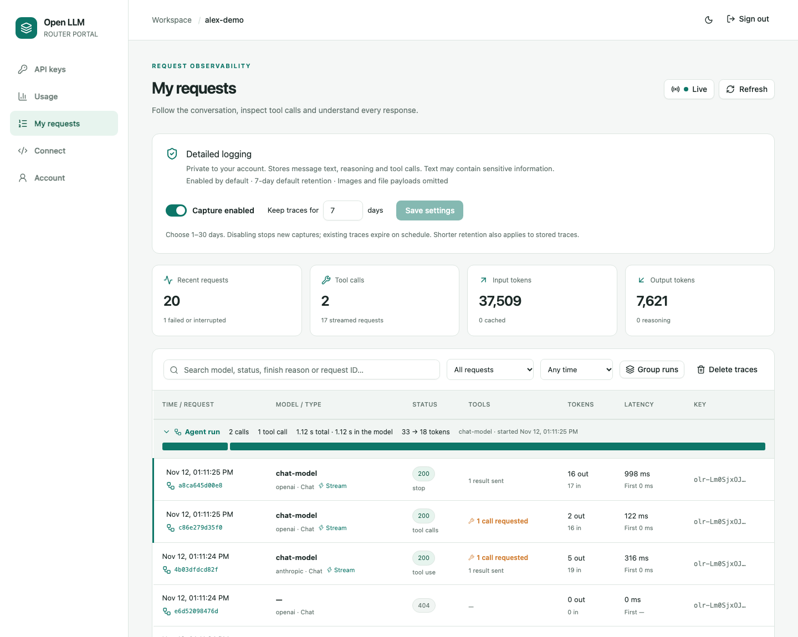
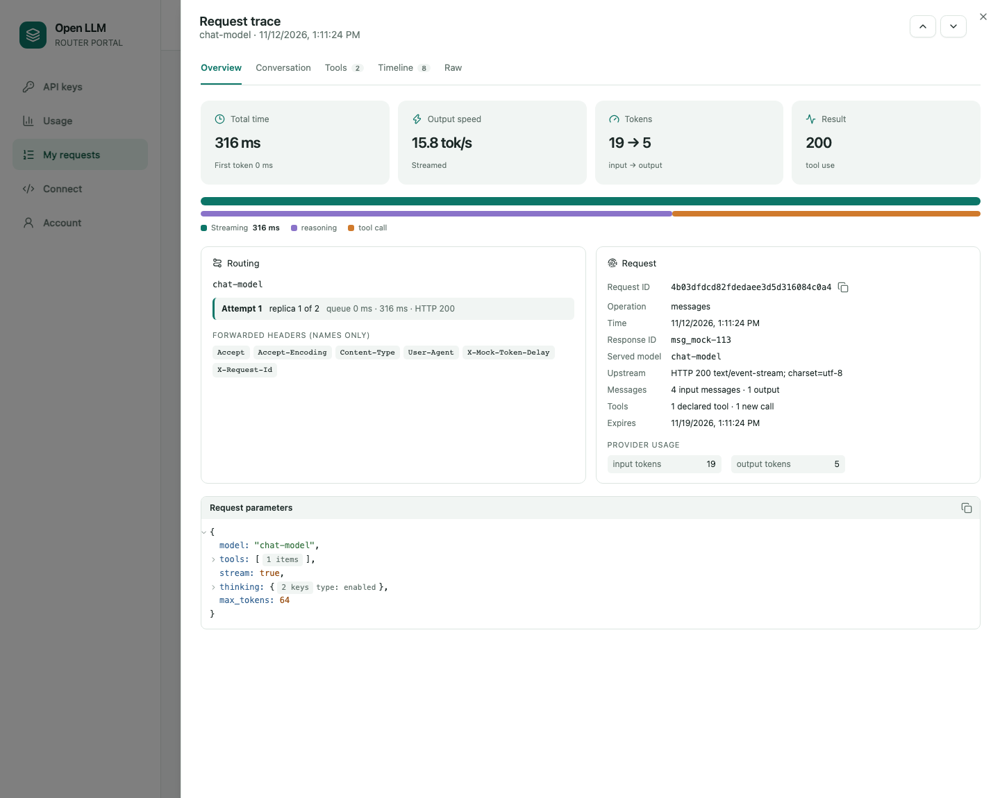
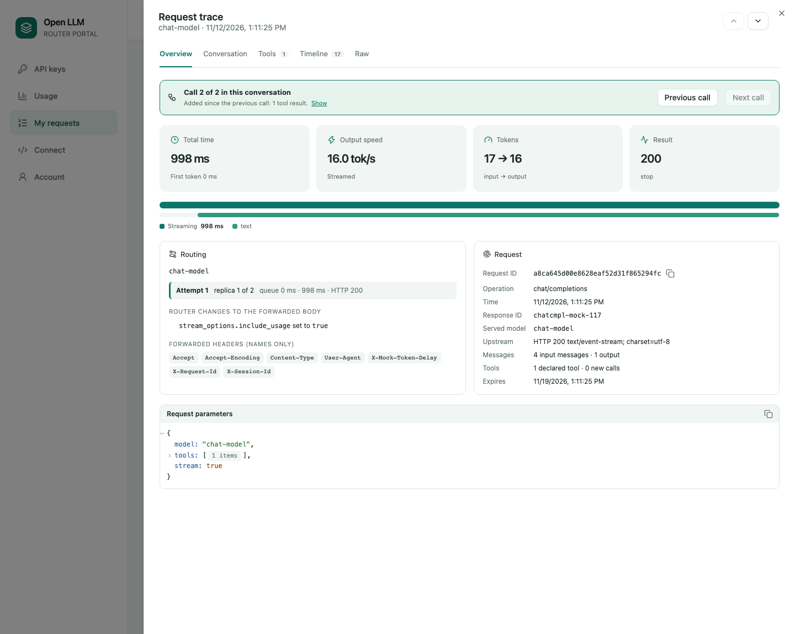

# Metrics, traces and request logs

## Protected Prometheus endpoint

Set a dedicated secret `OLR_METRICS_TOKEN` in the router environment. `GET /metrics`
on the normal HTTP port requires exactly one `Authorization: Bearer <token>` header.
API keys and portal cookies do not authorize it. With an empty setting, every scrape
is refused with 401. Configure Prometheus's `authorization.credentials_file` with
this token and use HTTPS outside local development. Never put tokens in query strings.

```yaml
scrape_configs:
  - job_name: olr
    scheme: https
    static_configs:
      - targets: [router.example.org]
    authorization:
      credentials_file: /run/secrets/olr_metrics_token
```

Counters and histograms describe authenticated proxy calls, including local model/
policy/limit rejections. They do not count portal, health, model-list or usage API calls.

| Metric | Type / meaning |
|---|---|
| `olr_requests_total` | completed calls, once per client call including failover |
| `olr_input_tokens_total`, `olr_output_tokens_total` | observed protocol usage |
| `olr_request_duration_seconds` | histogram of total proxy latency |
| `olr_time_to_first_token_seconds` | histogram of time to first upstream body byte |
| `olr_output_tokens_per_second` | histogram of measured streaming throughput |
| `olr_replica_in_flight` | gauge of current replica leases, including failed attempts until release |
| `olr_replica_healthy` | gauge: 1 for healthy/outside cooldown, otherwise 0 |
| `olr_queue_waiting{model}` | gauge of calls waiting for replica capacity; no replica label |
| `olr_limit_rejections_total` | rejections by `max_concurrent`, `max_concurrent_batch`, `rpm`, `tpm`, `tokens_per_day`, `tokens_per_month` |
| `olr_usage_write_failures_total`, `olr_usage_dropped_total` | failed database transactions and dropped queued records |
| `olr_database_reachable` | current database ping result, bounded to one second per scrape; 0 means database-dependent readiness fails |
| `olr_invalidation_listener_connected` | authentication invalidation listener is connected and usable |
| `olr_group_sync_enabled`, `olr_group_sync_interval_seconds` | configured sync state and interval; no labels |
| `olr_group_sync_runs_total{result}` | complete sync runs and initialization failures; result is `success`, `error` or `skipped` (another worker held the lock) |
| `olr_group_sync_last_success_timestamp_seconds` | Unix time of last complete successful sync; 0 until success with the current settings; skips and errors do not advance it |
| `olr_content_trace_writes_total`, `olr_content_trace_failures_total` | persisted optional traces and failed writes/retention operations; no labels |
| `olr_content_trace_deletions_total`, `olr_content_trace_dropped_total` | deleted traces and captures skipped by capacity, rate, storage or preference limits; no labels |
| `olr_content_trace_retention_backlog` | expired traces awaiting deletion at the last successful retention pass; no labels |
| `olr_build_info{version,commit,go_version}` | constant gauge of 1 identifying the binary; build-controlled labels |

Call metrics have only canonical configured `model`, configured replica origin,
`protocol` and `status_class` labels. Rejections have model/protocol/limit; pool gauges
have model/replica except the model-only queue gauge. Sync counters use a fixed result
label and build info uses fixed build identity; health/trace series have no labels.
Invalid model requests use an empty model label, preventing caller-
controlled cardinality. Status classes include `2xx`–`5xx`, `error` and `aborted`.
There are no user, key, group, request-ID or trace-ID metric labels. Standard Go and
process collectors are included. Counters reset on process restart.

First-byte timing is the same TTFB approximation stored in usage; it can include a
protocol role/start event before generated text. Throughput is output tokens divided
by latency after that byte, for streams with positive output and duration. Missing
measurements are not histogram observations. Usage accounting remains asynchronous;
metrics record the observed call even when its database write fails.

First-byte histogram buckets include 60, 120, 180, 300, 600, 900, 3600 and 7200 seconds,
so queues longer than 30 seconds remain measurable in finite buckets. OIDC retry logs
include a classified cause (for example DNS, connection refusal, timeout or HTTP status),
without URLs or provider response bodies. Group-sync failures log sanitized causes and
progress counts. A configured sync that has never succeeded remains at timestamp 0;
check client credentials and Keycloak's read-only admin scopes before trusting removals.

## Alerts and readiness

[`router-alerts.yml`](../deploy/observability/router-alerts.yml) ships rules for process
loss, database readiness loss, invalidation disconnects, sustained errors, accounting
loss, stale group sync, persistent queues, unhealthy replicas, long first-byte latency
and optional trace storage/retention failures. The local observability stack loads them.
For production, load the file through your Prometheus rule configuration or convert the
group into your Prometheus Operator's rule resource, and route `critical`/`warning`
alerts to the site's response channel. Thresholds are starting values for the pilot.

`up{job="olr"}` alone proves that `/metrics` responds. It stays 1 during a database
outage. `OLRDatabaseUnavailable` uses `olr_database_reachable == 0`, the same database
ping condition as `/readyz`, and fires after one minute even while metrics remain up.
An external HTTP/blackbox probe of `/readyz` is an alternative readiness signal; alert
on `probe_success == 0` for that specific target. Inference replica failures do not
make the administrative portal unready, so monitor replica/error/queue signals too.

The pilot's accounting stop condition is `OLRAccountingLoss`: **any increase** in
`olr_usage_dropped_total` or `olr_usage_write_failures_total` over five minutes. Check
database connectivity, writer logs and capacity before continuing acceptance. The
high-error rule requires over 5% errors for five minutes with at least 0.1 requests/s;
process loss has its own two-minute alert. Group-sync freshness alerts are conditional
on sync being configured and use twice the configured interval plus a ten-minute hold.
Trace drops can be expected when limits or preferences refuse capture; investigate
their rate rather than treating every skipped capture as an accounting failure.

CI runs `promtool check rules` and synthetic rule tests. The tests prove that a database
outage alerts while `up` remains 1 and that an accounting drop alerts independently.
To validate edited rules with the local stack:

```sh
docker compose --env-file .env -f deploy/compose/docker-compose.yml -f deploy/compose/observability.yml exec -T prometheus promtool check rules /etc/prometheus/router-alerts.yml
docker compose --env-file .env -f deploy/compose/docker-compose.yml -f deploy/compose/observability.yml exec -T --workdir /etc/prometheus prometheus promtool test rules router-alerts.test.yml
```

## Dashboard and local stack

[`deploy/observability/grafana/dashboards/open-llm-router.json`](../deploy/observability/grafana/dashboards/open-llm-router.json)
is a Grafana dashboard (uid `open-llm-router`, Prometheus datasource uid `prometheus`) with
requests and tokens per second, time to first token, duration and per-stream tokens per
second, in-flight calls and health per replica, the queue, rejections per limit, lost usage
records, vLLM's running/waiting requests and KV-cache usage, and router memory and
goroutines. It is generated by `deploy/observability/tools/dashboard.py`; edit the script and
regenerate rather than editing the JSON. Import it into any Grafana whose Prometheus
datasource has uid `prometheus`, or change the uid in the script.

`make observability-up` starts the development stack with Prometheus
(http://localhost:9091), Grafana with the dashboard provisioned (http://localhost:3001,
anonymous viewer) and Jaeger (http://localhost:16686) receiving the router's spans over
OTLP/HTTP; the router gets a development metrics token and `OTEL_EXPORTER_OTLP_ENDPOINT`.
List vLLM backends to scrape in `deploy/observability/vllm-targets.json`.
The Make target reads `.env` at the repository root, preserving the existing router's
port, database and backend settings. Copy `.env.example` there before using a direct
`docker compose --env-file .env -f ...` command. Set `OLR_METRICS_TOKEN` there to change
the development token: the router and Prometheus receive the same value. Prometheus
writes it to a private file at startup without printing it. Check `/targets` on
Prometheus for the `olr` target's `UP` state before using the dashboard.
`make observability-down` stops everything. To find one call, send it with a `traceparent`
header (or read the `trace_id` from the router's log line) and open
`http://localhost:16686/trace/<trace id>`.

## Optional OTLP/HTTP tracing

No tracing SDK provider/exporter is created unless an endpoint is set:

```sh
export OTEL_EXPORTER_OTLP_ENDPOINT=https://collector.example.org:4318
# Or an exact URL, taking precedence over the generic endpoint:
export OTEL_EXPORTER_OTLP_TRACES_ENDPOINT=https://collector.example.org/v1/traces
# Optional standard exporter headers (URL-encoded values):
export OTEL_EXPORTER_OTLP_HEADERS='Authorization=Bearer%20collector-token'
```

The exporter sends HTTP/protobuf, not gRPC. The generic endpoint gets `/v1/traces`
appended; the traces-specific URL is used as-is. HTTPS is recommended; HTTP supports
internal/local collectors. Credentials in endpoint URLs, queries and fragments are
rejected. Standard OTLP headers, timeout/retry behavior and certificate settings are
provided by the [OpenTelemetry Go exporter](https://opentelemetry.io/docs/languages/go/exporters/).
The router sets a five-second export timeout and flushes during graceful shutdown.
Compose passes these settings to the router; use a collector hostname reachable
from its container.

Each proxy call creates one client span, including calls rejected before an upstream
is selected. Failover stays within that span. W3C `traceparent`/`tracestate` are extracted,
the call retains the incoming trace ID, and the router span context is injected into
the backend request. Baggage is discarded. With tracing disabled, valid incoming
trace context can still propagate, but no new spans are recorded or exported.

Spans use the [GenAI attribute names](https://opentelemetry.io/docs/specs/semconv/registry/attributes/gen-ai/)
where defined: `gen_ai.provider.name`, `gen_ai.operation.name`, `gen_ai.request.model`,
`gen_ai.usage.input_tokens`, `gen_ai.usage.output_tokens` and
`gen_ai.response.time_to_first_chunk`. `http.response.status_code` is included for
numeric outcomes. Router-specific fields are `olr.protocol`, `olr.replica`, `olr.status`,
`olr.request.duration`, `olr.replica_selection.duration` (cumulative selection time in
seconds), and `olr.output.tokens_per_second` for streams. Groups are `olr.groups`.
The service name is `open-llm-router`. No prompt, response, request headers or keys
are passed to tracing. `OLR_TRACE_USER_ID=true` explicitly adds `enduser.id`;
it is false by default. It never adds user IDs to metric labels.

## Personal content traces

**My requests** provides opt-in content tracing (site-wide disabled by default) with a 7-day default lifetime and
user-selected 1–30 day retention. It stores private message, reasoning, tool and stream
event detail in Postgres. It does not send content to OTLP, metrics or server logs.
See [REQUEST_TRACING.md](REQUEST_TRACING.md) for controls, capture limits and performance
behavior. This is independent of the OpenTelemetry configuration above.



*The embedded portal with synthetic data and mock backends. The failed call is an
intentional unknown-model example. These timings are not benchmark results.*

With **Live** on, requests appear while they run. Agent runs are grouped with a bar
per call over time. Select a request ID to open its trace: **Overview** (timing
breakdown, routing attempts, router changes, the full request ID for correlation with
JSON logs and `X-Request-Id`), **Conversation**, **Tools** (calls paired with
results), **Timeline** and **Raw** (what was sent and forwarded).

| Overview | Agent run |
|---|---|
| [](REQUEST_TRACING.md#inspect-a-call) | [](REQUEST_TRACING.md#follow-an-agent-run) |

The [illustrated viewer guide](REQUEST_TRACING.md) also shows request parameters,
expiry and deletion controls. See [screenshot provenance and reproduction](images/README.md)
for the disposable demo setup.

## JSON request logs

One `msg=request` JSON line per request contains request ID, trace ID when available,
authenticated user ID and display-only key prefix, canonical model, replica, protocol,
HTTP status and accounting outcome, input/output tokens, nullable TTFB, and latency.
Probes are omitted when successful. Non-proxy requests have empty inference fields.
These logs intentionally contain user IDs; protect them according to the site's
retention policy. They contain no full keys, cookies, OAuth codes, query strings,
prompts or responses. Panic values are replaced with a generic marker.

Tests verify metric changes, nonzero/zero replica leases, trace propagation with an
in-memory exporter, default/opt-in user attributes and a prompt privacy marker across
spans, logs and metric labels.
