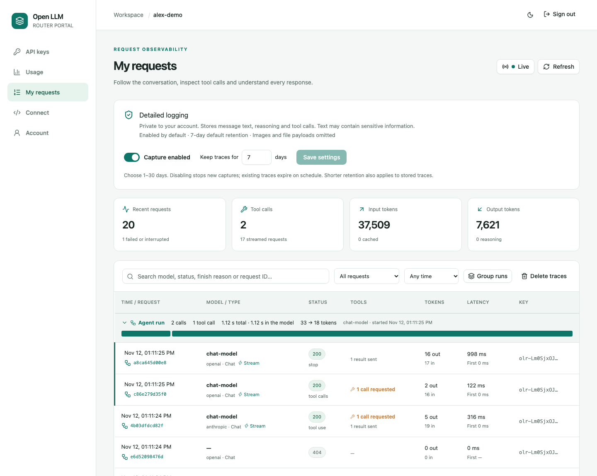
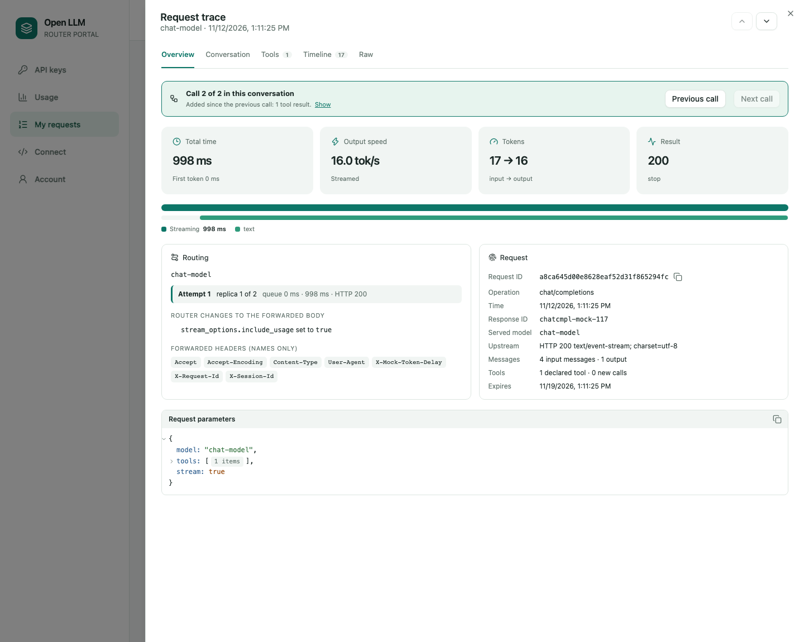
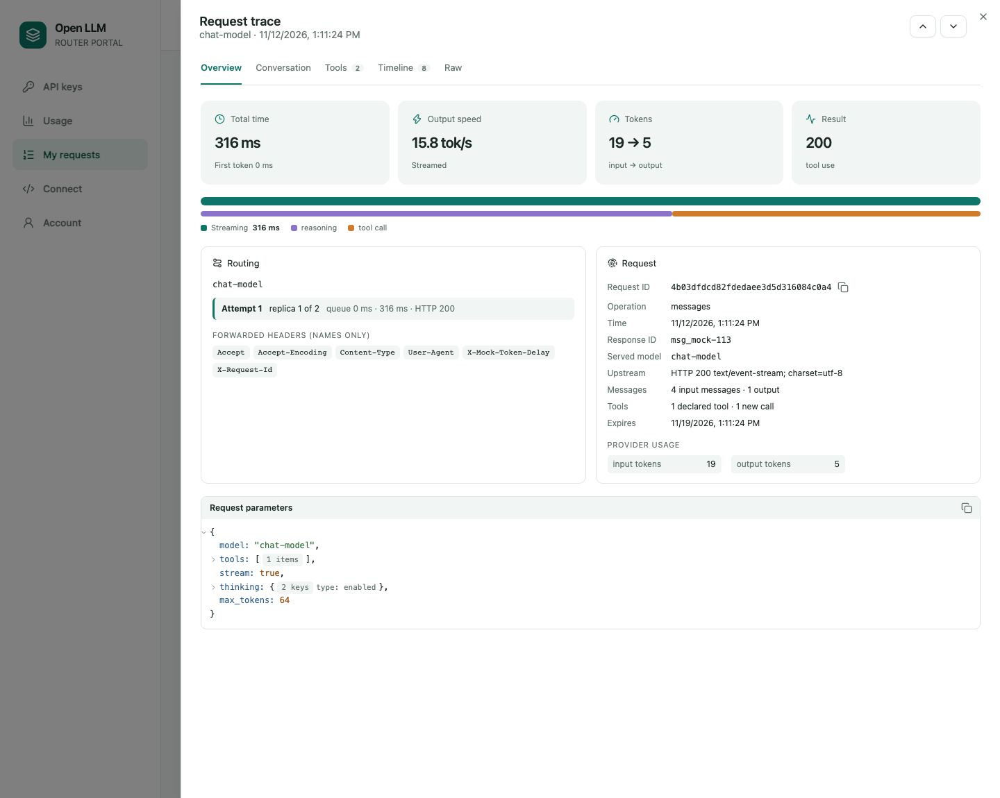
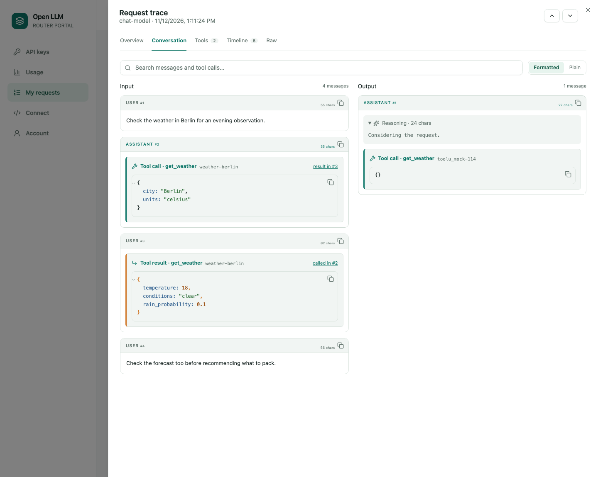
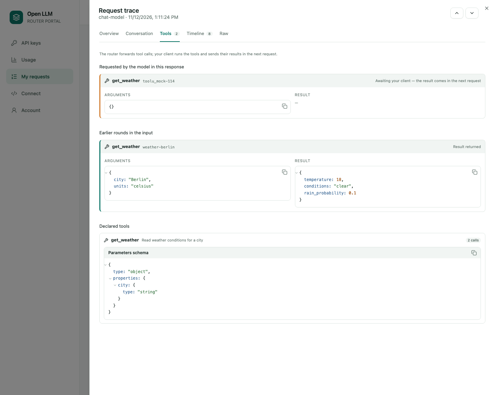
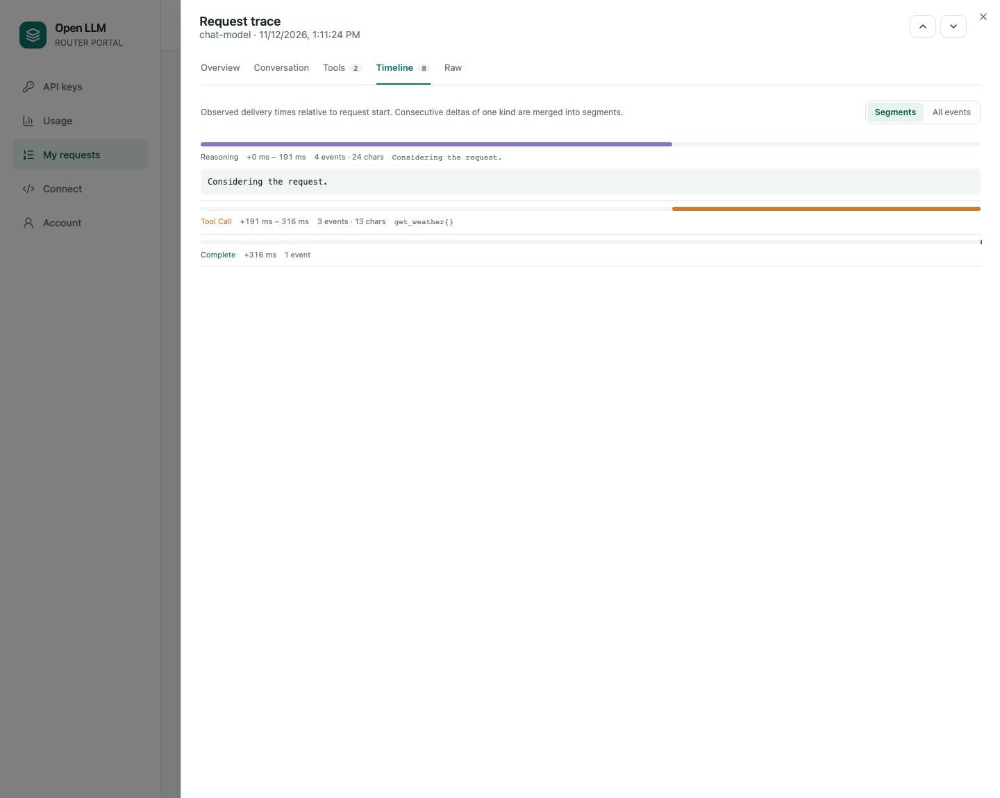
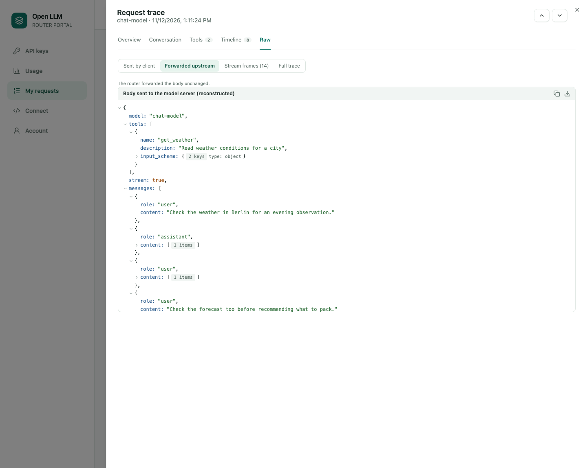

# Personal request tracing

Open **My requests** (`/portal/requests`) to inspect LLM calls made with your keys,
OIDC access token, or by a trusted application on your behalf. Detailed logging is
**enabled by default**, including for existing accounts. Retention defaults to
**7 days**; each user can choose **1–30 days** and save their own preference.

*Screenshots below are the real portal with disposable demo accounts and mock-backed
requests. All content and usage are synthetic; timings are not a performance
benchmark. [Capture workflow](images/README.md).*

## Use the trace viewer

1. Set **Capture enabled/disabled** and **Keep traces for**, then **Save settings**.
2. Make a call using an OpenAI or Anthropic client. With **Live** on (the default),
   the request appears at the top of the table as soon as the router accepts it, with
   a ticking elapsed time, whether it is still waiting for the model or receiving,
   and the bytes and chunks received so far. When it finishes, the completed row
   replaces it and is briefly highlighted. The trace becomes available shortly after
   completion, and a trace you opened while the request was running loads by itself.
   **Live** pauses updates (kept in the page address as `?live=off`; use **Refresh**);
   the button shows *Connecting*, *Reconnecting* or *Live unavailable · polling* when
   the stream is interrupted, and the page then refreshes every 5 seconds instead.
   Live events carry only metadata (IDs, model, timing, byte counts, status), never
   content. Existing historical requests cannot be backfilled.
3. Select a request ID in the table. The trace opens in a side panel with its own
   address (`/portal/requests/<request id>`), so a reload or bookmark reopens it. Press
   **j** / **k** or the arrow buttons to move to the next older or newer request.
   - **Overview:** total time, first token, output speed, tokens (cached and reasoning
     when the provider reports them) and the finish reason. A timing bar splits the
     call into admission, replica queue, failed attempts, waiting for the first byte and
     streaming; a second bar shows when reasoning, text and tool arguments arrived.
     **Routing** shows the requested → canonical → upstream model, every attempt by
     pool position, the router's changes to the forwarded body and the names of the
     forwarded headers. **Request** lists IDs, the served model, the upstream status,
     provider usage fields and all request parameters.
   - **Conversation:** input and output messages with Markdown formatting (or plain
     text), folded long prompts and folded earlier rounds of long agent loops, a copy
     button per message and a search that highlights matches. Tool calls link to the
     message holding their result, and results name the call they answer.
   - **Tools:** each tool call paired with its result by ID: arguments and result side
     by side, with a status (result returned, awaiting your client, or none). Calls
     the model requested in this response are listed first. **Declared tools** shows
     each tool's description, JSON schema and call count; calls to undeclared tools are
     flagged. The router forwards tool calls; your client executes them and submits
     their results in the next request.
   - **Timeline:** consecutive deltas merged into segments (for example 39 reasoning
     events, then 49 text events) on a time axis; expand one to read its text. **All
     events** shows the individual deltas, filterable by type, in pages of 100.
   - **Raw:** the request body as the client sent it, the body forwarded to the model
     server (the client body with the router's recorded changes applied), the response
     body or the first 200 stream frames, and the full normalized trace. Each view is a
     collapsible JSON tree with copy and download buttons. Omitted content appears as
     markers such as `«image payload omitted»`.
4. Search the table by model, status, finish reason, protocol, operation or request ID;
   filter for streams, failures, requests with detail, tool calls or truncated capture;
   and limit the time range. The **Tools** column shows how many calls the model
   requested and how many results the client sent. Filters are kept in the page
   address.

Timing cards show total latency, time to first byte (labelled first token), token
counts and estimated output speed. Event times measure when the router observed
delivery to the client, including backpressure; several events in one network read
can have the same timestamp. They are not provider token-generation timestamps.
Interrupted calls keep their partial, complete SSE events and have `aborted`
status; an SSE error has `error` status.

## Follow an agent run

With **Group runs** on (the default; `?group=off` lists every call flat), the calls of
one conversation are grouped under an **Agent run** header: number of calls and tool
calls, time from the first request to the end of the last versus time spent in the
model, tokens and models. The bar below places every call on the run's time axis; the
gaps are time spent in your client, typically executing tools. Select a bar to open
that call; collapse a run with its arrow.

Calls belong to one run when they share the client's `X-Session-Id` header or, without
it, the same system prompt and first user message while the input keeps growing (an
agent loop appends; repeating one prompt starts a new run each time). Send
`X-Session-Id` from your agent for exact grouping.

In a grouped call, **Overview** shows its position (*Call 2 of 2*), what it added since
the previous call (for example *1 tool result*) and **Previous call** / **Next call**.
**Conversation** marks those messages *new in this call* and the resent previous
response as *previous response*, and keeps them visible when earlier rounds are
folded. In **Tools**, a call the model requested links to the next call, where your
client sent its result.

## Inspect a call

**Overview** answers where the time went and what the router did. Use the full
**Request ID** to correlate the call with the response's `X-Request-Id` header and
JSON server logs. **Expires** shows when its content becomes inaccessible.

**Conversation** shows what the client submitted, including earlier tool calls and
their results, and what the model returned. Expand **Reasoning** to read thinking
emitted by the provider. In this mock example, the response requests another
`get_weather` call; the client would execute it and send its result in a later request.

**Tools** pairs every call with its result and shows each declared tool's schema.

**Timeline** preserves the observed order of reasoning, text and tool argument
fragments. Event times are relative to request start.

**Raw** shows exactly what was sent: the client's body, the body forwarded upstream
with the router's changes, and the response, with omitted payloads as markers.

## Privacy and retention

- Content is private to the **attributed user**. Admin privileges do not permit
  reading another account's detailed traces. A trusted forwarder's owner cannot
  read traces attributed to the forwarded user. Database operators/backups still
  have access: protect Postgres, disk encryption and backups accordingly.
- Captured text includes prompts, responses, reasoning, tool arguments/results and
  provider error messages. It may contain sensitive information. There is no
  automatic secret detector inside user text. Disable capture before sending
  content you do not want retained.
- HTTP header values, credentials, cookies, provider signatures and encrypted
  reasoning, `metadata` fields, image/file/audio payloads, attachment URLs, data URIs,
  base64 blobs and embedding vectors are omitted. Images, documents and audio appear
  as markers such as `«image payload omitted»`. Supported text/reasoning/tool fields
  are normalized; unknown provider-specific content fields are omitted.
- Besides the conversation, a trace stores what is needed to understand a call: a
  sanitized preview of the raw request JSON (strings over 2 KiB shortened; full text is
  in the conversation), every non-content parameter, tool names, descriptions and
  schemas (8 KiB each), the router's changes to the forwarded body (upstream model
  name, priority, `stream_options.include_usage`), the names (never values) of headers
  forwarded upstream, admission and queue waits, attempts identified by pool position
  ("replica 1 of 2", never a backend address) with classified errors, upstream status
  and media type, response IDs/model/finish reasons/numeric usage, a sanitized raw
  response preview and up to 200 raw stream frames.
- Requests are grouped into conversations by a keyed hash, per user, of the client's
  `X-Session-Id` header, or otherwise of the system prompt and first user message.
  Message hashes mark which input is new between calls of an agent loop. Hashes never
  leave the user's own traces.
- Disabling capture stops new content collection on that router immediately and
  invalidates pending/in-flight captures. Existing traces remain until their
  original expiry or explicit deletion. On another router, preference snapshots
  refresh every 15 seconds; the database always rechecks opt-out and generation
  before persisting a capture. A stale instance cannot save opted-out content.
- Shortening retention shortens existing traces too. Extending it applies to new
  traces and does not extend older expiry dates or recover deleted content.
- Expired detail is immediately inaccessible. A separate cleanup deletes up to
  1,000 expired traces every 15 seconds. Cleanup failure/backlog does not make
  expired content readable. Retention applies to the live database; backup
  expiry is an operator responsibility.
- **Delete traces** deletes only content, preserving request metadata and totals.
  **My usage → Delete my activity** removes both per-request metadata and content.
  Both invalidate pending captures. Daily quota totals remain. Deleting the user
  cascades to all their traces. Exported OpenTelemetry spans are separate.
- The browser fetches content only when opening a trace, releases its query cache
  on close, and does not persist content to local/session storage. Trace responses
  use the portal's `no-store` policy and normal full-session/Origin protections.

## Performance and operational limits

The forwarding path performs no tracing SQL and no content JSON decoding. It copies
bounded bytes after writing to the client; two background workers normalize content
and write it to `request_traces`, independently of the usage/accounting queue.
Streaming responses still flush incrementally. Tracing neither retries nor delays
an inference call when its storage queue is full or Postgres fails.

Bounds per request are **1 MiB copied input**, **384 KiB stored input text**,
**128 KiB per raw preview**, **256 KiB output**, **2,048 observed writes**, **1,000
displayed stream events** and **200 raw stream frames (64 KiB)**. At most **32
captures** can be active or queued per process. Input over 1 MiB is omitted as a whole,
because partial JSON is never decoded; binary payloads are removed before the text
budget applies, so a request with images keeps its text. Output keeps only its
captured prefix and complete events. The viewer explains truncation; forwarding is
unaffected. Parsing/serialization has additional bounded worker memory/CPU
cost. No external telemetry SDK or service is required for personal tracing.

Capacity pressure skips new traces rather than blocking inference. The table shows
**No detail** for skipped, disabled, expired, pending and pre-upgrade requests.
Metadata-only `request traces skipped` warnings report cumulative `dropped` and
`failed` counts, at most once every 15 seconds. Storage operations have a 2-second
deadline. Shutdown drains the proxy first, then allows up to 2 seconds for content
writes; pending content can be lost during shutdown or outages. Quota accounting
continues through its existing independent queue and shutdown flush.

Supported calls are `/v1/chat/completions`, `/v1/completions`, `/v1/embeddings` and
`/v1/messages`. Models/discovery/count-tokens and authentication failures are not
personal content traces. Router admission errors and upstream errors are traced for
authenticated, attributed inference requests. Usage records retain their separate
site-configured lifetime (90 days by default), daily totals 400 days by default.

Live updates use one server-sent event stream per open **My requests** page, at most
4 per user and router instance. The forwarding path does a clock read per write and,
at most every 500 ms and only while the user has the page open, a nonblocking
in-memory publish. Lifecycle events (started, finished, trace ready) reach users
connected to other router instances through Postgres `NOTIFY` on the `olr_activity`
channel, batched every 250 ms; each instance keeps one database connection in
`LISTEN` state. Progress ticks stay on the instance serving the request. Events a
slow connection cannot take are dropped; the page reconciles with the request list
on every finished event and every 30 seconds. Streams recheck the session every 15
seconds, end on sign-out, and close at shutdown, so they never delay a graceful stop.
Reverse proxies must not buffer `text/event-stream` responses (the router sends
`X-Accel-Buffering: no`); a read timeout above 15 seconds suffices.

See [PORTAL_API.md](PORTAL_API.md#personal-trace-settings-and-content) for the API,
[PRIVACY.md](PRIVACY.md) for the notice template, and
[OBSERVABILITY.md](OBSERVABILITY.md) for metadata-only metrics, logs and OTLP spans.
